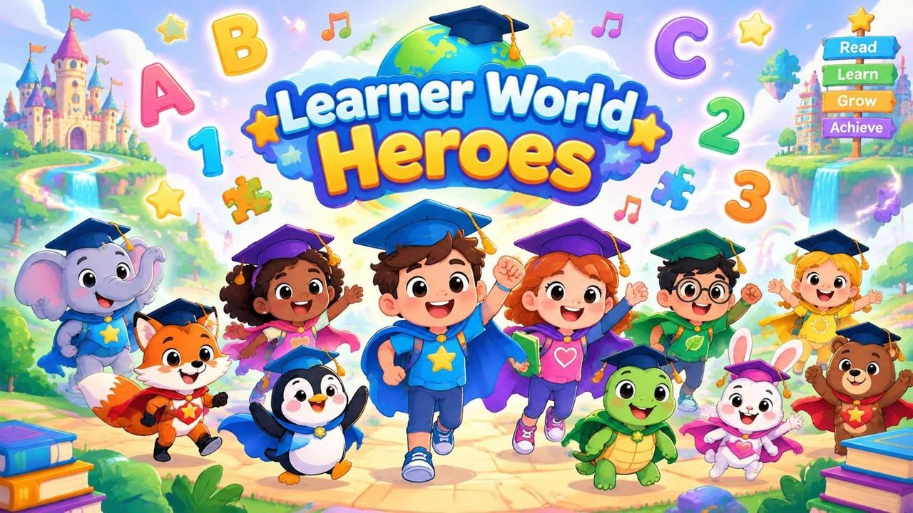

# Learner World Heroes · أبطال العالم المتعلمين



Offline-first educational PWA for kids aged 2–8 (Arabic + English, RTL/LTR). Vanilla HTML/CSS/JS — **no build step, no dependencies, no ads, no network calls**.

## Modes
- **2–4 Little Explorers:** shape matching, animal-sound matching, tap-to-color.
- **5–8 Smart Adventure:** counting & addition, letter↔picture matching (AR/EN), memory cards, interactive story.

Stars + confetti reward every round; stars buy hats, capes and accessories for a companion (robot or animal). Settings are behind a parental gate (multiplication question). Progress lives in `localStorage`. All sounds are synthesized with the Web Audio API.

## Structure
```
index.html · manifest.webmanifest · sw.js
css/styles.css
js/store.js   progress persistence
js/audio.js   synthesized SFX + speech
js/ui.js      helpers, translations, confetti, avatar, parental gate
js/games.js   all mini-games (quiz engine, memory, story…)
js/app.js     screens, shop, settings, routing
icons/            app icons (PNG 192/512, Apple touch, SVG)
assets/cover.jpg  key art shown on the welcome screen / README
assets/logo.png   cropped title logo
```

## Run
```
python3 -m http.server 8080     # or: npx serve .
```
Open http://localhost:8080 (service worker needs http/https, not file://).

## Publish to GitHub
```
git init && git add . && git commit -m "Learner World Heroes"
git branch -M main && git remote add origin <your-repo-url> && git push -u origin main
```
Then Settings → Pages → deploy from `main` / root.

## Next steps
Add more stories/words, and bump `V` in `sw.js` on each release.
